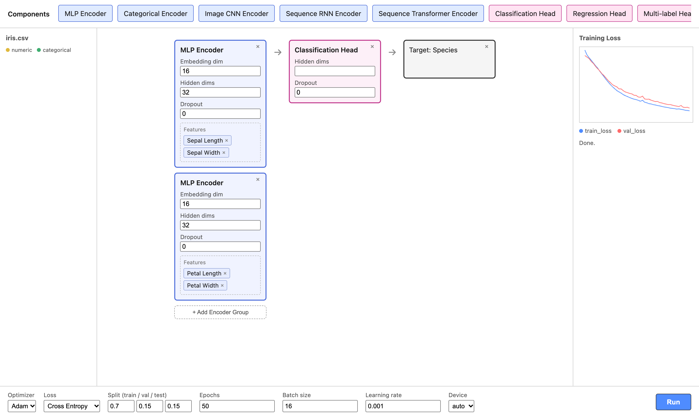

# DeepScratch

A small, modular deep learning framework in PyTorch, written from scratch, with a drag-and-drop **playground** for building and training models on tabular CSV data.



Build a model from **encoders** (one per group of feature columns) and a **head**. Pick a target column and hyperparameters, press **Run**, and the loss curves update live while it trains.

## Quick start

Requires Python 3.11+.

```bash
git clone <this-repo-url> deepscratch && cd deepscratch
python -m venv .venv && source .venv/bin/activate
pip install -e .
```

### Playground (UI)

```bash
python playground/server.py        # optional: pass a port, default 8765
```

This opens `http://127.0.0.1:8765` in your browser. To build a model:

1. Drag an encoder from the top bar into an encoder group.
2. Drag feature columns from the left panel into that group. Numeric columns go to an MLP encoder and categorical columns to a Categorical encoder.
3. Drag a head into the head slot and a column into the target slot.
4. Set the training options in the bottom bar and press **Run**.

The playground uses the first `.csv` file in `data/`. Iris is included.

### Command line

The playground writes `config.yaml` and then runs `entrypoint.py`. You can do the same thing by hand:

```bash
# edit config.yaml (data, encoder groups, head, trainer), then:
python entrypoint.py
```

## What a run produces

Each run is saved to `runs/<timestamp>-<run-name>-<id>/`:

| Path | Contents |
| --- | --- |
| `config.yaml` / `config.json` | the exact config used |
| `metadata.json` | run id, timestamp, task type, input path |
| `artifacts/` | final model, model summary, data schema, split indices, label mapping |
| `checkpoints/` | model checkpoints saved during training |
| `logs/`, `metrics/` | training log and per-epoch metrics |

## Project layout

```
src/deepscratch/
  data/       data modules (tabular CSV, splits, feature-type inference)
  encoders/   mlp, categorical, cnn, rnn, transformer + MultiEncoder
  heads/      classification, regression, multilabel, projection, sequence_tagging
  trainers/   training loop
  runs/       run context, logging, checkpoints, artifacts
  pipeline.py encoder → head model
entrypoint.py builds everything from config.yaml and trains
playground/   stdlib HTTP server + vanilla JS frontend
```

> **Note:** the playground lists every encoder and head type. The data pipeline is tabular only, though, so the CNN, RNN and Transformer encoders raise a clear shape error if you use them. Use the MLP and Categorical encoders with the Classification and Regression heads for working runs.
